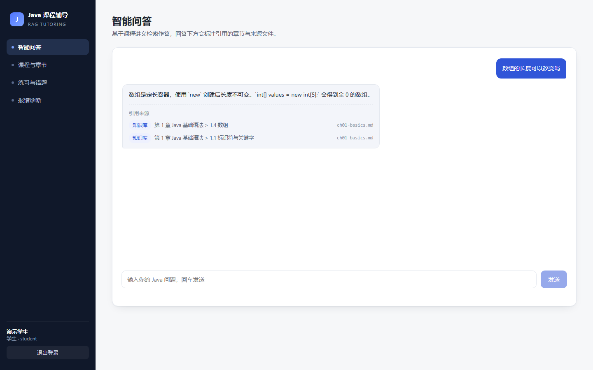
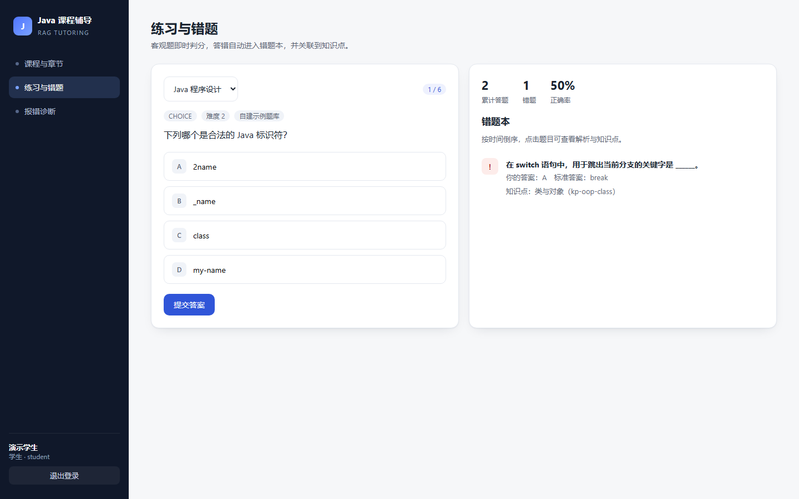
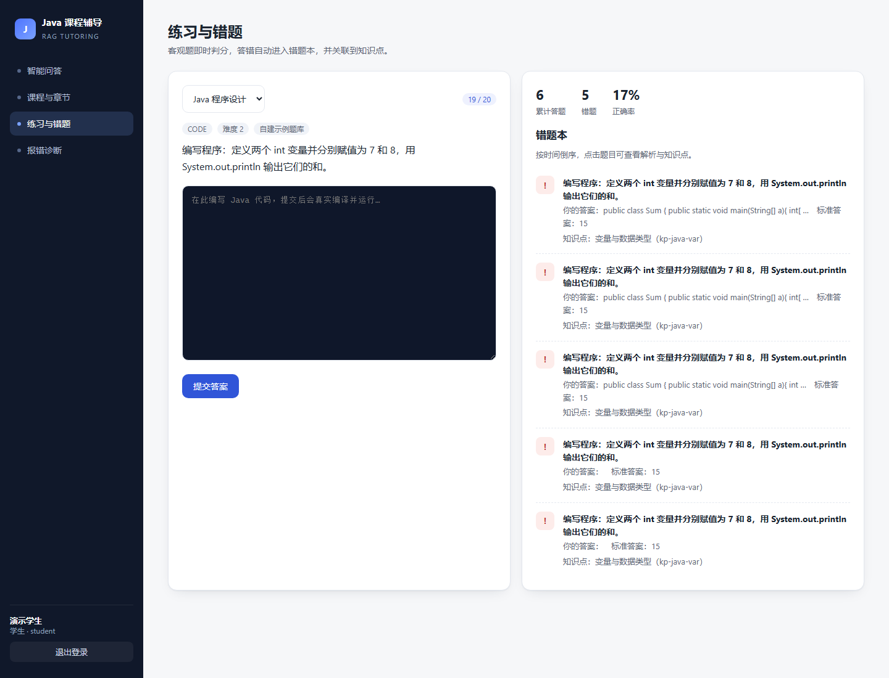
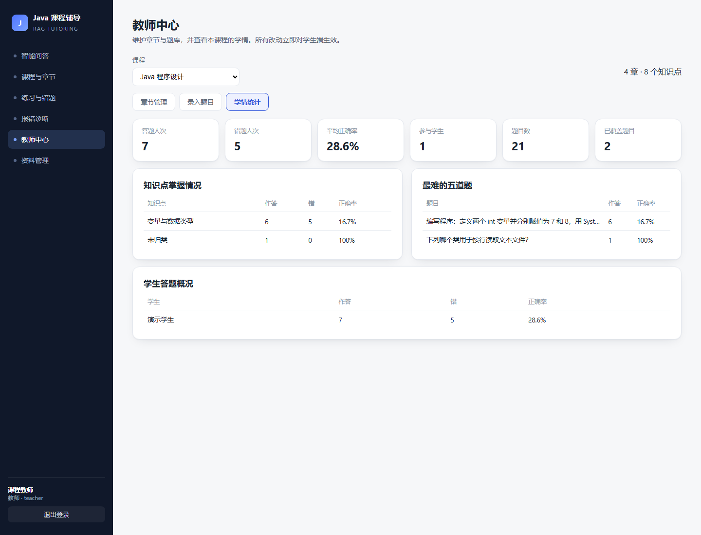

# 基于 RAG 的 Java 程序课程辅导系统

本科毕业设计项目。面向《Java 程序设计》课程，把课程讲义、代码示例、题库与 javac 报错组织成可检索、可判分、可溯源的知识库。

**完整项目文档：[docs/项目文档.md](docs/项目文档.md)**

## 能力一览

| 能力 | 说明 | 文档 |
| --- | --- | --- |
| 智能问答 | 自然语言提问，答案分点并给出「第几章第几节 + 来源文件」 | [接口说明](docs/接口说明.md) |
| 代码感知切分（C1） | 代码块不被切断，切分带语言/符号元数据 | [代码感知切分](docs/代码感知切分.md) |
| 编译报错诊断（C2） | 贴 javac 报错 → 错误类型 / 原因 / 修改建议，8 类案例 8/8 命中 | [报错诊断](docs/报错诊断.md) |
| 判分与错题溯源（C3） | 5 种题型；编程题真实编译运行；错题追到知识点 | [接口说明](docs/接口说明.md) |
| 可量化评测（C4） | 四组对照：纯向量 / 纯词面 / 混合 / 混合+小节重排 | [评测方法](docs/评测方法.md) |
| 教师端 | 上传讲义即入库、建章、出题、学情统计 | [项目文档 §5.5](docs/项目文档.md) |

## 技术栈

Vue 3 + Vite（5173）→ Spring Boot 3.3 + JPA + MySQL 8（18082）→ Python FastAPI（9000）。
检索与回答当前为**离线降级模式**：无需大模型 Key、无需 Milvus，接口契约与真实服务一致。

## 快速开始

```powershell
powershell -ExecutionPolicy Bypass -File scripts\start-all.ps1
```

打开 <http://127.0.0.1:5173>，演示账号：

- 学生 `student / 123456`
- 教师 `teacher / 123456`

停止：`scripts\start-all.ps1 -Stop`。手工四进程启动方式见 [运行指南](docs/运行指南.md)。

## 界面

| 智能问答 | 练习与错题 |
| --- | --- |
|  |  |

| 代码题判分 | 教师端学情 |
| --- | --- |
|  |  |

## 数据规模

| 数据 | 规模 |
| --- | --- |
| 课程讲义 | 4 章（基础语法 / 面向对象 / 集合与异常 / IO 流），60 个片段 |
| 题库 | 20 道演示题（5 种题型，含 2 道编程题） |
| 报错案例 | 8 类（6 编译 + 2 运行时） |
| 评测集 | 21 题（Recall@1 0.905、MRR 0.952） |
| 数据表 | 12 张 |

## 测试

```powershell
cd backend; mvn test                               # Java 18 个
.\.venv\Scripts\python.exe -m pytest tests -q      # Python 41 个
.\.venv\Scripts\python.exe scripts\evaluate_retrieval.py   # 四组对照
```

## 目录

```
backend/          Spring Boot：controller / service / model / config
frontend/         Vue 3：8 个页面（问答、课程、练习、诊断、资料、教师中心…）
education_rag/    C1 切分、文档解析、向量化
web/              离线检索服务（FastAPI）
data/             corpus / eval / errors
scripts/          start-all.ps1、评测、报错采集、冒烟
docs/             项目文档、接口说明、评测方法、报错诊断、运行指南
```

## 说明

检索底座来自 EduRAG（上游 `taurusru1/knowledge_base-study`）。本课题新增：Java 课程语料与题库、代码感知切分 C1、javac 报错诊断 C2、代码判题与错题溯源 C3、四组对照评测 C4、教师端与三端业务链路。
教学语料仅用于本地演示，不随仓库分发。
