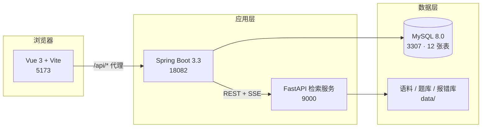
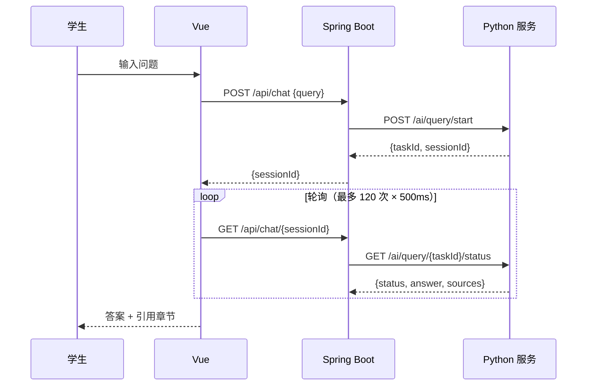
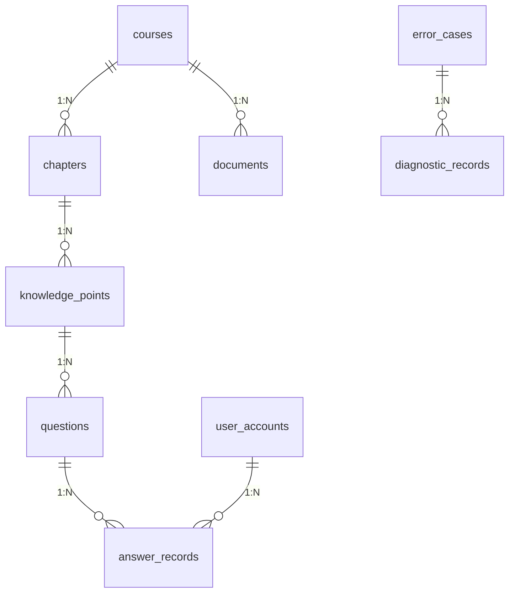

# 基于 RAG 的 Java 程序课程辅导系统 · 项目文档

> 版本 v1.0 ｜ 最后更新 2026-11-11 ｜ 仓库 <https://github.com/taurusru1/java-course-rag>

---

## 1. 项目概述

### 1.1 题目

**基于 RAG 的 Java 程序课程辅导系统设计与实现**

### 1.2 一句话定位

把「课程讲义 + 代码示例 + 题库 + javac 报错」组织成可检索、可判分、可溯源的知识库，让学生用自然语言或一段报错就能拿到**带出处的答案**，让教师能看到**谁在哪儿卡住**。

### 1.3 与普通文档问答的区别

普通 RAG 只回答「概念是什么」。本系统额外做了四件事（也是论文的四个创新点）：

| 编号 | 能力 | 通俗解释 |
| --- | --- | --- |
| C1 | 代码感知切分 | 代码块不会被拦腰切断，切分结果带「语言 / 符号 / 是否代码」元数据 |
| C2 | 编译报错诊断 | 贴一段 javac 报错，直接给出错误类型、原因、改法，并关联知识点 |
| C3 | 判分与错题溯源 | 五种题型真实判分，编程题真的编译运行；错题能追到章节与知识点 |
| C4 | 可量化评测 | 四组对照实验（纯向量 / 纯词面 / 混合 / 混合 + 小节重排）与失败分析 |

### 1.4 当前状态

| 项目 | 状态 |
| --- | --- |
| 三端是否跑通 | ✅ Vue 5173 → Spring Boot 18082 → Python 9000 |
| 语料 | 4 章 Java 讲义（基础语法 / 面向对象 / 集合与异常 / IO 流），**60 个片段** |
| 题库 | 20 道演示题（5 种题型，含 2 道编程题），教师端可继续录入 |
| 报错库 | 8 类真实 javac 报错，端到端 **8/8 命中** |
| 测试 | Java **18** 个、Python **41** 个，全部通过 |
| 检索评测 | 21 题评测集，混合 + 小节重排 R@1 **0.905**、MRR **0.952** |
| 大模型 | 未接入（无可用 Key），当前为**离线降级模式**，接口契约与真实服务一致 |

---

## 2. 需求分析

### 2.1 用户角色

| 角色 | 能做什么 |
| --- | --- |
| 学生 | 智能问答、按章节练习、提交代码、看错题与学习统计、贴报错求诊断 |
| 教师 | 上传讲义并自动入库、维护章节、录入题目、查看班级学情 |

### 2.2 功能需求

| 编号 | 需求 | 实现位置 |
| --- | --- | --- |
| FR1 | 学生用自然语言提问，答案必须给出来源章节 | `Chat.vue` → `/api/chat` → `web/offline_service.py` |
| FR2 | 答案要能定位到「第几章第几节、来自哪个文件」 | `citation_from_record()` |
| FR3 | 支持按课程、章节筛题，五种题型可作答 | `Practice.vue` → `/api/practice/*` |
| FR4 | 编程题要真实编译运行，输出与期望不符要指出差异 | `CodeJudgeService` |
| FR5 | 答错后能看解析，并能按知识点回看错题 | `PracticeService.wrongAnswers()` |
| FR6 | 粘贴编译/运行报错，返回错误类型、原因、修改建议 | `DiagnoseService` + `error_cases` |
| FR7 | 教师上传讲义后，学生立刻能检索到新内容 | `DocumentService` → `/ai/import/start` |
| FR8 | 教师能看到知识点掌握度、最难的题、学生答题概况 | `TeacherStatsService` |

### 2.3 非功能需求

- **可复现**：一条 `scripts/start-all.ps1` 起全部服务；数据全部在仓库内（`data/corpus`、`data/eval`、`data/errors`）。
- **可降级**：没有大模型 Key、没有 Milvus 也能完整演示（离线打分 + 检索式回答）。
- **可扩展**：新增一门课只需上传 Markdown；新增一类报错只需往 `error_cases.json` 加一条。
- **安全**：学生接口不返回答案与解析；教师接口统一 `RoleGuard` 校验。

---

## 3. 系统架构

### 3.1 三端结构



为什么分三端：

- **Spring Boot** 承担鉴权、业务事务、题库与统计这类「关系型」工作，符合 Java 课程辅导系统的教学定位；
- **Python** 承担解析、切分、向量化、检索与生成，生态最成熟；
- **Vue** 只做展示，通过 Vite 代理转发 `/api`，避免跨域。

### 3.2 关键链路

**问答链路**



**导入链路**


### 3.3 技术选型

| 层 | 选型 | 理由 |
| --- | --- | --- |
| 前端 | Vue 3 + Vite + axios | 轻量、热更新快，毕设演示足够 |
| 后端 | Spring Boot 3.3 + JPA + MySQL | Java 课程背景契合，事务与鉴权成熟 |
| 检索引擎 | Python + 自研打分 | 免去 Milvus/GPU 依赖，答辩环境零故障 |
| 切分 | 自研 `CodeAwareSplitter` | 通用切分器会把代码块切断（见 §5.1） |
| 判题 | javac + java 子进程 | 真实编译运行，比字符串比对可信 |

---

## 4. 数据模型

### 4.1 表清单（12 张）

| 表 | 作用 | 关键字段 |
| --- | --- | --- |
| `user_accounts` | 账号与角色 | account、password_hash、role、display_name |
| `auth_sessions` | 登录令牌 | token、user_id、expires_at |
| `students` | 学生档案 | student_no、name、college、major、grade |
| `courses` | 课程 | name、code、department、semester |
| `chapters` | 章节 | course_id、chapter_no、title、summary |
| `knowledge_points` | 知识点 | code（唯一）、name、chapter_id、difficulty |
| `questions` | 题库 | type、stem、options_json、answer、analysis、knowledge_point_id |
| `answer_records` | 答题记录 | user_id、question_id、user_answer、is_correct、score |
| `error_cases` | 报错案例库 | error_code（唯一）、category、javac_pattern、cause、solution |
| `diagnostic_records` | 诊断历史 | user_id、raw_error、matched_case_id、confidence |
| `documents` | 讲义文件 | file_name、doc_type、status、task_id、course_id |
| `chat_histories` | 问答历史 | student_id、question、answer、sources_json |

### 4.2 关系



> `chapters` / `knowledge_points` 在实体里用 `course_id`、`chapter_id` 外键列直连（非 JPA 关联），
> 避免懒加载序列化问题；`documents` 仍保留 `@ManyToOne`，因此建表时必须有 `course_id`。

### 4.3 教育元数据（片段级）

每个检索片段都带下列字段，检索、引用、评测都依赖它：

| 字段 | 示例 | 用途 |
| --- | --- | --- |
| `course_name` | Java 程序设计 | 课程过滤 |
| `chapter_name` / `chapter_path` | 第 2 章 面向对象编程 > 2.4 多态 | 引用与命中判定 |
| `knowledge_point` | 接口与多态 | 错题溯源 |
| `source_file` | ch02-oop.md | 出处 |
| `page_number` | PDF 页码（可选） | 出处 |
| `is_code` / `code_language` / `code_symbols` | true / java / [Person, speak] | C1 的代码感知依据 |

---

## 5. 核心实现

### 5.1 C1 代码感知切分

**问题**：常规按长度切分，会把一个 `class` 从中间切开——上半段有 `public class Person {`，下半段只剩方法体，检索到时学生看到的是一段无法运行的代码。

**做法**（`education_rag/code_chunking.py`）：

1. `parse_markdown_units()` 先按 Markdown 结构切成「散文 / 代码」两类单元。围栏支持 ``` 与 ~~~、长度 ≥3，围栏内的 `#` 不当标题。
2. 代码单元**整块保留**；只有超过 `max_chars` 才切，且：
   - 用 `_line_depths()` 统计花括号深度（跳过字符串、字符、注释）；
   - 只在「深度回到类体层级且该行以 `}` 结尾」处切；
   - 每片重新带上类的声明头，保证每片可独立阅读。
3. `detect_language()` 与 `extract_symbols()` 识别语言与符号（类/方法名），写入元数据。
4. `CodeAwareSplitter` 在拼接上下文时生成 `【Java 代码】课程｜章节路径｜结构：A、B`。

**效果**（`scripts/compare_chunking.py`，max_chars=600）：

| 切分方式 | 片段数 | 代码围栏完整率 | 被切断的代码块 |
| --- | --- | --- | --- |
| 常规切分 | 9 | 67% | 3 |
| C1 代码感知 | 17 | **100%** | **0** |

### 5.2 混合检索与小节重排

打分公式（`web/offline_service.py`）：

```
score = 0.5 × cosine(query, chunk) + 0.5 × lexical_score(query, chunk)

lexical_score = 0.8 × 查询词覆盖率 + 0.2 × log(1+tf) 重合率
```

- 停用词表 `STOPWORDS` 去掉「的、了、是、什么、意思」等虚词，避免「多态是什么意思」被虚词稀释；
- 小节重排：同一小节的多个片段先聚合，`小节分 = 最高片段分 + 0.03 × (命中片数-1)`（上限 0.12），
  再把同一小节的前 3 个片段拼成完整上下文交给回答层；
- 引用只保留**真正拼进答案**的小节，避免「检索到但没用」的章节被标成出处；
- 答案末尾会检查问句里的英文标识符是否在上下文出现过，没讲到就显式声明「讲义中暂未讲到 xxx」。

### 5.3 C2 编译报错诊断

链路：

```
学生贴报错 → POST /api/diagnose
  → 正则匹配 error_cases.javac_pattern（命中 0.9）
  → 否则按 error_code 关键词匹配（全中 0.7）
  → 都不到 0.5 视为未命中
  → 写 diagnostic_records，返回原因 + 修改建议 + 关联知识点
```

案例库 8 类，正则同时覆盖中英文（中文 Windows 的 javac 输出是 GBK）：

| error_code | 类别 |
| --- | --- |
| cannot_find_symbol | 编译错误 |
| incompatible_types | 编译错误 |
| missing_return_statement | 编译错误 |
| duplicate_variable | 编译错误 |
| missing_semicolon | 编译错误 |
| non_static_context | 编译错误 |
| null_pointer | 运行时异常 |
| array_index_out_of_bounds | 运行时异常 |

采集脚本 `scripts/collect_javac_errors.py` 真实调用 javac/java 抓输出，解码顺序为
`locale.getpreferredencoding(False) → gbk → utf-8`（中文 Windows 上 javac 输出 GBK，按 UTF-8 解会乱码）。

### 5.4 C3 判分与错题溯源

| 题型 | 判分规则 |
| --- | --- |
| CHOICE / JUDGE | 忽略大小写与首尾空白 |
| MULTI | 字母排序后比较（`AC` 与 `c,a` 判等） |
| FILL | 去空白、转小写后比较 |
| CODE | **真实编译运行**：写临时目录 → `javac`（10s 超时）→ `java`（10s 超时）→ 输出逐行比对 |

编程题的三种失败都会被区分：

1. 编译失败 → 直接返回 `compileError`，并调用 `DiagnoseService.explain()` 给出诊断；
2. 编译通过但抛异常（输出含 `Exception in thread`）→ 同样走诊断；
3. 输出与期望不符 → 返回实际输出、期望输出、耗时。

每次提交写 `answer_records`；`/api/practice/wrong` 把错题、标准答案、解析、知识点串起来。

### 5.5 教师端

| 功能 | 接口 | 说明 |
| --- | --- | --- |
| 上传讲义 | `POST /api/documents` | 落盘后调 `/ai/import/start`，解析入库耗时显示在状态里 |
| 新增章节 | `POST /api/chapters/courses/{id}` | 章节号自动 +1 |
| 录入题目 | `POST /api/practice/questions` | 5 种题型，选项每行一个自动补 `A.` 前缀 |
| 学情统计 | `GET /api/teacher/stats?courseId=` | 汇总 + 知识点 + 最难 5 题 + 学生概况 |

---

## 6. 接口清单

| 模块 | 方法与路径 | 说明 |
| --- | --- | --- |
| 认证 | `POST /api/auth/login` | 入参 account / password / role，返回 token |
| | `GET /api/auth/me` / `POST /api/auth/logout` | 当前用户 / 退出 |
| 课程 | `GET /api/courses`、`GET /api/courses/{id}` | 课程列表与详情 |
| | `GET /api/courses/{id}/chapters` | 章节列表 |
| | `GET /api/courses/{id}/knowledge-points` | 知识点列表 |
| 练习 | `GET /api/practice/questions?courseId=&chapterId=` | 题目列表（不含答案） |
| | `POST /api/practice/submit` | 提交作答，返回判分结果 |
| | `GET /api/practice/wrong` / `GET /api/practice/stats` | 错题本 / 学习统计 |
| 诊断 | `POST /api/diagnose` | 贴报错求诊断 |
| | `GET /api/diagnose/cases`、`/cases/grouped` | 案例库 |
| 问答 | `POST /api/chat` | 发起提问 |
| | `GET /api/chat/{sessionId}` | 轮询结果（answer + sources） |
| | `GET /api/chat/{sessionId}/stream` | SSE 流式 |
| 资料 | `GET/POST/DELETE /api/documents` | 讲义管理 |
| 教师 | `POST /api/chapters/courses/{id}`、`PUT/DELETE /api/chapters/{id}` | 章节维护 |
| | `GET /api/teacher/stats` | 学情统计 |
| 健康 | `GET /health` | Spring Boot 健康检查 |
| Python | `GET /health`、`POST /ai/query/start`、`GET /ai/query/{taskId}/status` | 检索服务 |
| | `POST /ai/import/start`、`GET /ai/import/{taskId}/status` | 讲义导入 |

完整字段说明见 [docs/接口说明.md](接口说明.md)。

---

## 7. 部署与运行

### 7.1 环境要求

| 依赖 | 版本 | 说明 |
| --- | --- | --- |
| JDK | 17 | `JAVA_HOME=D:\Develop\JDK\jdk-17` |
| Maven | 3.9+ | 打包后端 |
| Node.js | 18+ | 前端 |
| Python | 3.11 | `.venv`（uv 创建） |
| Docker | 任意 | 只用来跑 MySQL 8.0 |

### 7.2 一键启动

```powershell
powershell -ExecutionPolicy Bypass -File scripts\start-all.ps1
```

脚本依次完成：启动 MySQL 容器 → 启 Python 服务 → 编译并启后端 → 装依赖并启前端 → 等待端口就绪 → 打印地址与账号。

停止：

```powershell
powershell -ExecutionPolicy Bypass -File scripts\start-all.ps1 -Stop
```

### 7.3 手工启动（四进程）

```powershell
# 1. MySQL（127.0.0.1:3307，库 javacourse_kb）
docker compose -f docker-compose.dev.yml up -d

# 2. Python 检索服务（9000）
.\.venv\Scripts\python.exe -m uvicorn web.offline_service:app --host 127.0.0.1 --port 9000

# 3. 后端（18082）
D:\Develop\JDK\jdk-17\bin\java.exe -jar backend\target\javacourse-backend-0.0.1-SNAPSHOT.jar --server.port=18082

# 4. 前端（5173，必须指定后端地址，否则代理打到 8080）
cd frontend
$env:VITE_API_TARGET='http://127.0.0.1:18082'
npm run dev
```

演示账号：`student / 123456`（学生）、`teacher / 123456`（教师）。

### 7.4 常见问题

| 现象 | 原因 | 解决 |
| --- | --- | --- |
| 前端白屏、接口 404 | Vite 代理默认 8080，被别的进程占用 | 启动前设 `VITE_API_TARGET=http://127.0.0.1:18082` |
| 后端启动报 `Schema-validation: missing column` | 表结构与实体不一致 | 执行 `docker exec -i javacourse-mysql mysql -uroot -pjavacourse javacourse_kb < db/schema.sql` |
| 重新打包报 `Unable to rename ... jar` | 旧进程还占着 jar | 先停后端进程再 `mvn package` |
| 中文显示乱码（仅控制台） | PowerShell 按 Latin-1 解 UTF-8 | 不影响浏览器；脚本里用 `[Text.Encoding]::UTF8.GetBytes()` 发请求 |
| 上传后检索不到 | 文件哈希重复或解析失败 | 看 `/ai/import/{taskId}/status` 的 `status` 字段 |

---

## 8. 测试

### 8.1 测试分布

| 范围 | 数量 | 覆盖点 |
| --- | --- | --- |
| Java 单元测试 | 18 | 判分规则、报错匹配、代码判题（含超时与编译失败）、学情聚合、健康检查 |
| Python 单元测试 | 41 | C1 切分、离线检索、引用生成、导入去重、javac 案例库一致性 |

运行：

```powershell
cd backend; mvn test          # Java
.\.venv\Scripts\python.exe -m pytest tests -q   # Python
```

### 8.2 端到端验证记录

| 场景 | 结果 |
| --- | --- |
| 学生登录 → 提问「多态是什么意思」 | 命中 2.4 多态与向上转型，引用 ch02-oop.md |
| 学生提交编程题（正确代码） | `correct=true`，输出 15，耗时 730ms |
| 学生提交缺分号代码 | `compiled=false`，诊断 `missing_semicolon`，置信度 0.9 |
| 学生提交数组越界代码 | 编译通过、运行异常，诊断 `array_index_out_of_bounds`，给修改建议 |
| 8 条真实 javac 报错 POST /api/diagnose | **8/8 命中，全部走正则（0.9）** |
| 教师上传 `ch04-io.md` | 片段 53 → 60，学生立刻能问到 `BufferedReader.readLine()` |
| 学生调教师接口 | 三个接口均返回 **403** |

---

## 9. 实验与评测

### 9.1 设置

- 评测集：21 道题（三章各 7 道，`data/eval/java_qa.json`），每题标注期望章节与必须命中的要点词；
- 语料：53 个片段（三章），后续加第 4 章后复测结果不变；
- 指标：Recall@1、Recall@3、MRR、要点命中率（Top-1 正文是否覆盖全部要点）。

### 9.2 四组对照

| 策略 | Recall@1 | Recall@3 | MRR | 要点命中率 |
| --- | --- | --- | --- | --- |
| 纯向量（128 维哈希） | 0.762 | 0.857 | 0.826 | 0.714 |
| 纯词面（覆盖率） | 0.905 | 1.000 | 0.952 | 0.857 |
| 混合（0.5 向量 + 0.5 词面） | 0.905 | 1.000 | 0.952 | 0.809 |
| **混合 + 小节重排** | **0.905** | **1.000** | **0.952** | **0.905** |

复现：

```powershell
.\.venv\Scripts\python.exe scripts\evaluate_retrieval.py
```

### 9.3 结论

1. 在这个规模的中文技术讲义上，**词面信号已接近天花板**；128 维哈希向量没有带来增益，反而让要点命中率下降（0.857 → 0.809），因为它把语义相近但要点不同的片段排了上来。
2. **小节重排是唯一稳定正向的改进**：片段级指标不变，但答案上下文从「一个片段」变成「同一小节的前三段」，要点命中率 0.857 → 0.905。
3. 失败集中在两类：q02（泛型题被「强制类型转换」字面碰撞）、q20（现象在 3.2、原理在 3.7，跨小节）。

### 9.4 负结果（写进论文更有说服力）

| 尝试 | 结果 | 结论 |
| --- | --- | --- |
| 概念问句对代码片段降权（0.05–0.3 五档） | 指标完全不变 | 无依据，已删除 |
| 小节「覆盖增益」加权 0.10 | 指标完全不变 | q02/q20 不是覆盖不足 |
| 纯词频（w_tf=0.5） | R@1 掉到 0.762 | 词频会放大长片段，需停用词 + 覆盖率 |

---

## 10. 演示脚本（约 8 分钟）

1. **登录**：学生账号进入，首页是智能问答。
2. **问答**：问「多态是什么意思？」——答案分点、引用「第 2 章 2.4 多态与向上转型」；再问「HashMap 和 Hashtable 有什么区别？」——只讲了 HashMap 时会明确声明「讲义中暂未讲到 Hashtable」。
3. **练习**：切到「练习与错题」，答一道选择题，故意答错 → 看到解析与知识点；再答一道编程题，先贴缺分号的代码 → 看到编译错误 + 诊断建议；改正后 → 通过，显示耗时。
4. **诊断**：把刚才的报错贴进「报错诊断」，展示错误类型 / 原因 / 修改建议。
5. **教师端**：换教师账号 → 上传一份新讲义 → 回到学生端提问新内容，证明「上传即可检索」；再展示学情统计（知识点正确率、最难的题、学生概况）。
6. **收尾**：打开 [docs/评测方法.md](评测方法.md) 讲四组对照与负结果。

---

## 11. 目录结构

```
java-course-rag/
├─ backend/                     Spring Boot 后端
│  ├─ db/schema.sql             12 张表
│  └─ src/main/java/com/javacourse/kb/
│     ├─ controller/            认证、课程、练习、诊断、问答、资料、教师
│     ├─ service/               PracticeService、CodeJudgeService、DiagnoseService、
│     │                         TeacherStatsService、DocumentService、ChatService
│     ├─ model/                 12 个实体
│     └─ config/                DataSeeder、RoleGuard、异常处理
├─ frontend/                    Vue 3 前端（8 个页面）
│  └─ src/views/                Chat、CourseList、Practice、Diagnose、Documents、Teacher、Login
├─ education_rag/               C1 切分、解析、向量化、入库
├─ web/offline_service.py       离线检索服务（FastAPI）
├─ data/
│  ├─ corpus/java/              4 章讲义 + uploads/
│  ├─ eval/java_qa.json         21 题评测集
│  └─ errors/                   8 个报错样例 + javac_errors.json
├─ scripts/                     start-all.ps1、评测、采集、冒烟
└─ docs/                        项目文档、接口说明、评测方法、报错诊断、运行指南
```

---

## 12. 已知限制与后续工作

| 限制 | 影响 | 计划 |
| --- | --- | --- |
| 无大模型 Key | 回答是「摘录式」，不是生成式 | Key 到位后接 `qwen-flash`，补第四臂「纯 LLM」对比 |
| 语料仅 4 章 | 覆盖面有限 | 扩到 8 章（含多线程、JVM 基础） |
| 题库 20 道 | 练习量偏少 | 扩到 60 道，按知识点均衡 |
| 代码题只比 stdout | 无法做方法级断言 | 引入 JUnit 模板 + 反射调用 |
| 无 Milvus | 十万级以上片段会变慢 | 保留 `MilvusRepository`，数据量上来后切换 |
| 会话历史页面未做 | 后端接口已就绪 | 前端补「历史记录」抽屉 |
